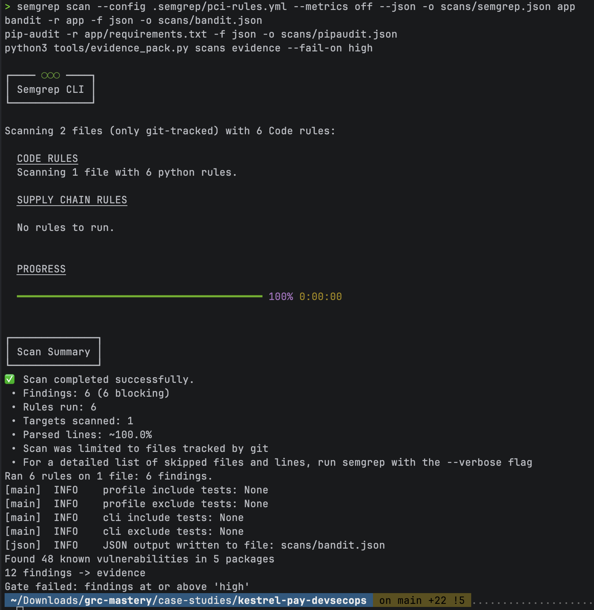
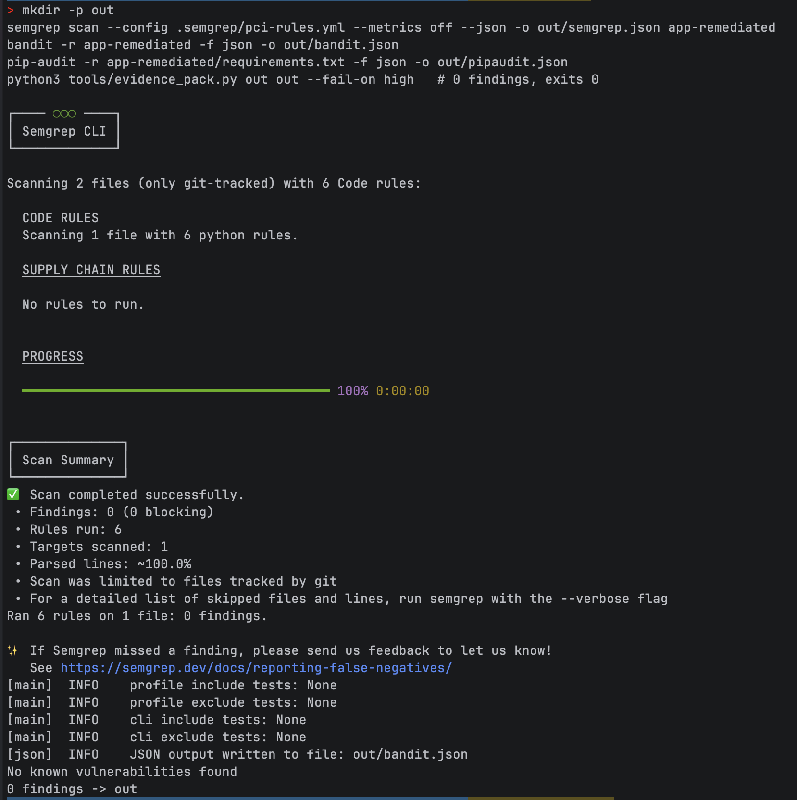

# Kestrel Pay — Securing a payment API's SDLC, end to end

> **Simulated engagement.** Kestrel Pay is a fictional payment-software vendor, and the vulnerable code was written for this exercise. The tools, scan results, rules and scripts are real, and you can reproduce them. I built this to show the work an Information Security Officer at a payments company does. It is not client work.

**The brief.** I join Kestrel as Information Security Officer. Engineering ships a Refunds & Card Lookup API to acquiring banks, and a PCI assessment is coming. The job: bring security into the SDLC, find out where the real risk is in the code, and make the evidence audit-ready.

## What I did

| Step | Activity | Output |
|---|---|---|
| 1 | Scoped the work and mapped the requirements: PCI DSS v4.0.1, PCI SSF, ISO 27001:2022, DORA, GDPR | [01 Context and scope](docs/01-context-and-scope.md) |
| 2 | Threat-modelled the API with the team lead (STRIDE, 8 threats) | [02 Threat model](docs/02-threat-model.md) |
| 3 | Reviewed the code manually and with SAST, SCA and secret scanning. Wrote **custom Semgrep rules for PCI data** | [03 Code review findings](docs/03-code-review-findings.md) · [`.semgrep/pci-rules.yml`](.semgrep/pci-rules.yml) |
| 4 | Fixed every finding in a remediated build and re-scanned it | [`app/`](app/) → [`app-remediated/`](app-remediated/) |
| 5 | Built a CI pipeline: report-only on the vulnerable app, a **blocking gate** on the fixed one | [workflow](../../.github/workflows/kestrel-devsecops.yml) |
| 6 | Wrote a Python script that turns scanner output into a control-mapped, hashed evidence pack | [`tools/evidence_pack.py`](tools/evidence_pack.py) · [`evidence/`](evidence/) |
| 7 | Turned the findings into business risks, with a FAIR estimate for the worst one | [04 Risk register](docs/04-risk-register.md) |
| 8 | Ran an internal audit of the SDLC itself against ISO 27001 A.8.25–8.29 and PCI DSS Req 6 | [05 Internal audit](docs/05-internal-audit-sdlc.md) |
| 9 | Set the testing calendar, briefed the pen tester, ran the assessor evidence tracker | [06 Testing and assessor liaison](docs/06-testing-and-assessor-liaison.md) |
| 10 | Wrote a one-page secure coding standard and a 60-minute developer training | [07 Standard and training](docs/07-secure-coding-standard-and-training.md) |

## Results

| | Before | After |
|---|---|---|
| Semgrep (custom PCI/OWASP rules) | 6 | 0 |
| Bandit | 5 | 0 |
| Dependency advisories (pip-audit) | 27 | 0 |
| Normalised unique findings | **12** (2 critical, 8 high) | **0**, gate passes |
| Findings only a human caught | 3 of 10: unmasked PAN, no refund limit, cross-tenant read | — |
| Audit result | — | 1 major NC (code review skipped on 6 of 15 PRs), 3 minor, 1 good practice |
| Top risk, R-01 card data in logs | ≈ €95k annualised loss exposure | Treatment cost ≈ €6k |

## Decisions worth asking me about

- **Why I threat-modelled before scanning:** three of the most serious issues are logic flaws that no scanner flags.
- **Why custom rules:** no off-the-shelf ruleset knows that `cvv` in a log line is a PCI breach.
- **The false positive I created and fixed:** gate credibility depends on rule tuning.
- **Why the audit is major on code review, not on scanning:** the control the organisation had already defined was the one that failed.
- **Why I excluded my own pipeline from the audit's conformity conclusion:** independence.

## Reproduce it

From `case-studies/kestrel-pay-devsecops` (macOS/Linux):

```bash
python3 -m venv .venv && source .venv/bin/activate
pip install semgrep bandit pip-audit

# 1. Vulnerable app: the gate should block
semgrep scan --config .semgrep/pci-rules.yml --metrics off --json -o scans/semgrep.json app
bandit -r app -f json -o scans/bandit.json
pip-audit -r app/requirements.txt -f json -o scans/pipaudit.json
python3 tools/evidence_pack.py scans evidence --fail-on high     # exits 1

# 2. Remediated app: the gate should pass
mkdir -p out
semgrep scan --config .semgrep/pci-rules.yml --metrics off --json -o out/semgrep.json app-remediated
bandit -r app-remediated -f json -o out/bandit.json
pip-audit -r app-remediated/requirements.txt -f json -o out/pipaudit.json
python3 tools/evidence_pack.py out out --fail-on high            # exits 0
```

Bandit and pip-audit return non-zero when they find issues. On the vulnerable app that's expected.

### Run on my machine

**Vulnerable app.** Semgrep finds 6 issues with the custom rules. pip-audit reports 48 advisory entries across 5 packages; many are the same advisory listed under more than one ID or for more than one requirement. The evidence script de-duplicates everything into 12 unique findings and the gate blocks.



**Remediated app.** 0 Semgrep findings, no known vulnerable dependencies, 0 findings in the evidence pack. The gate passes.



All card numbers are PCI test values. **Don't deploy `app/`**; it's deliberately vulnerable.
