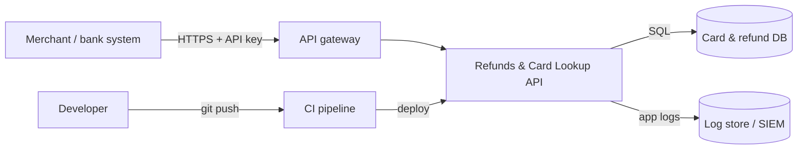

# 02 — Threat model (STRIDE)

Built in a 45-minute session with the API team lead, before any code was reviewed. The aim was to know what the API must protect before deciding where to look.

## Data flow

Trust boundaries: internet → gateway; gateway → API; API → data stores; developer → CI → production.

## STRIDE findings

| # | Element | STRIDE | Threat | Existing control | Gap → design requirement |
|---|---|---|---|---|---|
| T1 | Refund endpoint | **S**poofing / **E**levation | Anyone who can reach the API issues refunds | API key on *some* routes | Every route authenticated by one shared decorator. Merchant identity bound to the key, not taken from user input |
| T2 | Card lookup | **I**nformation disclosure | A merchant reads another merchant's cards by changing `merchant_id` | None | Tenant ID taken from the authenticated identity, never from the query string |
| T3 | Card lookup | **T**ampering | SQL injection through `merchant_id` | None | Parameterised queries only. SAST rule enforced in CI |
| T4 | Log store | **I**nformation disclosure | PAN/CVV in logs is readable by everyone with log or SIEM access | None | No sensitive authentication data anywhere. PAN masked before logging |
| T5 | Refund endpoint | **T**ampering | Refund amount manipulated without limit | None | Server-side limit and validation. Refunds above the threshold need dual approval |
| T6 | Refund endpoint | **R**epudiation | A merchant disputes having requested a refund | Free-text log line | Structured audit event: merchant, key ID, amount, timestamp, request ID |
| T7 | CI → production | **T**ampering | A vulnerable dependency or a leaked secret ships | None | SCA and secret scanning are blocking gates. Secrets come from a vault |
| T8 | API host | **D**enial of service / **I** | Debug console exposed | None | Debug off in all non-local builds. Hardened config baseline |

## What changed because of the model

- Code review prioritised T1, T2 and T4. Those are the threats where a single bug moves money or exposes card data.
- T2 and T5 are **logic flaws that no scanner flags**, so they went to manual review and into the pen test brief (see [06](06-testing-and-assessor-liaison.md)).
- T6 became a new logging requirement in the secure coding standard ([07](07-secure-coding-standard-and-training.md)).
